# Kaduna eDQA Portal — Administrator guide

This guide is for the people who run the portal from day to day: they bring in each quarter's
Data Quality Assessment submissions, sort out the ones that fail checks, and publish the round.
You do not need to know how the portal is built.

The screenshots come from the portal's own end-to-end test (`make e2e-round`), which runs a
whole round on test data. The names, facilities and figures in them are made up.

**Contents**

1. [Two sides of the portal](#1-two-sides-of-the-portal)
2. [Signing in, and the account rules](#2-signing-in-and-the-account-rules)
3. [The pages, one by one](#3-the-pages-one-by-one)
4. [Running a round from start to finish](#4-running-a-round-from-start-to-finish)
5. [What each data issue means and how to fix it](#5-what-each-data-issue-means-and-how-to-fix-it)
6. [Duplicates and deletions between ODK Central and KoboToolbox](#6-duplicates-and-deletions-between-odk-central-and-kobotoolbox)
7. [What must be done on ODK Central or KoboToolbox instead](#7-what-must-be-done-on-odk-central-or-kobotoolbox-instead)
8. [Things to remember](#8-things-to-remember)

---

## 1. Two sides of the portal

- **The public dashboard** is open to anyone, with no sign-in. It has six pages: Home, Facility
  view, LGA view, Monitor, Visuals and Implementation plan. It shows **closed rounds only**.
  It never shows assessor names, photos, data issues or anything you do in the admin area.
- **The admin area** is where you work. It lives under `/admin` and needs a sign-in. Every
  administrator can do everything. There are no separate roles.

While you are signed in, the public pages show an **Admin preview** bar at the top. The preview
also lets you look at the open round's figures. Visitors never see that bar or the open round.

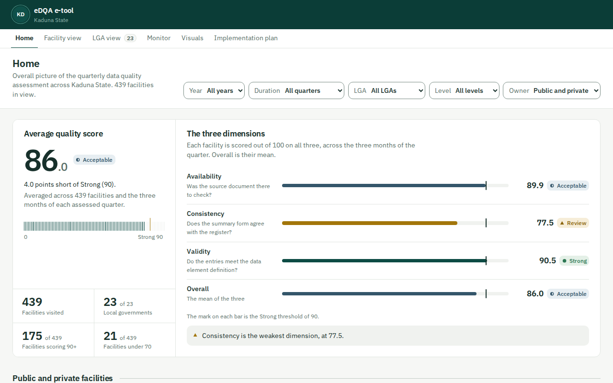

---

## 2. Signing in, and the account rules

### How to reach the sign-in page

There is **no link to sign in** anywhere on the public dashboard. To sign in, type the address
yourself: the dashboard's address followed by **`/login`**. For example,
`https://<the portal's address>/login`. Bookmark it.

Sign in with your **email address and password**. You land on the admin area's first page,
Data sources.

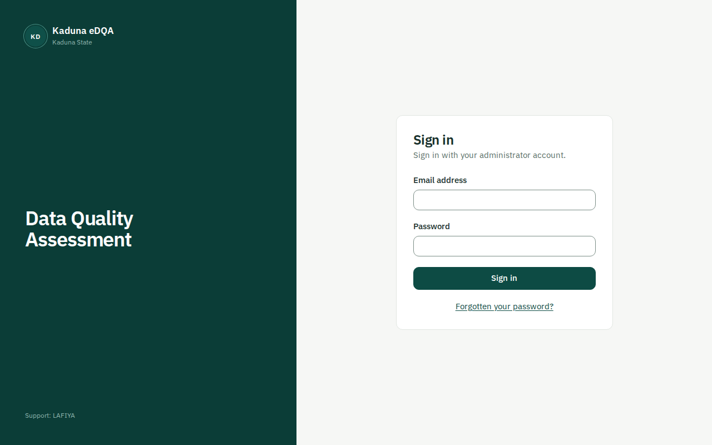

### Accounts

- Each administrator has their own account. Never share one. The audit log records who did what.
- Accounts are created on the server by the technical team (`edqa:admin:create`). They cannot be
  created from the portal.
- To leave, use **Log out** at the bottom of the left-hand menu. You land on the public dashboard.
- A session ends after a period of inactivity, and always 12 hours after you signed in.

### The password rules

A password must:

- be at least **14 characters** long;
- contain **upper- and lower-case letters**, at least one **number** and one **symbol**;
- not appear in any known list of leaked passwords (the portal checks this when you set it);
- not be one of **your last 5 passwords**.

Change your password on **My account**. Changing it signs you out everywhere else, for example
on another computer.

There is no second factor, such as a code by text message. The password is the only thing
protecting the account. Use a password manager, and never reuse a password from another site.

### Lockouts

Wrong passwords lock the account for a while. The pause grows each time:

| Wrong passwords in a row | The account is locked for |
|---|---|
| 5 | 15 minutes |
| 10 | 1 hour |
| 20 | Until the technical team unlocks it (`edqa:admin:unlock`) |

The sign-in page never says whether an email address has an account. If you are locked out
until unlocked, ask the technical team. Another administrator cannot unlock you from the portal.

### New-device emails

When someone signs in to an account from a computer or network not seen for 90 days, the portal
**emails every administrator**. The email gives the time, the network address and the browser.

- If it was you on a new laptop or network, there is nothing to do.
- If it was **not** you, change your password at once (My account). Then tell the other
  administrators and the technical team.

### The IP allow-list (optional)

The technical team can restrict sign-in to known networks, such as the office or a VPN. If that
is switched on and you are anywhere else, `/login` and every admin page answer **"Not found"**.
That is deliberate: connect to an allowed network and try again. It is off unless the client
asked for it.

---

## 3. The pages, one by one

The left-hand menu lists the admin pages. A number beside **Data issues** shows how many issues
are open.

### Data sources

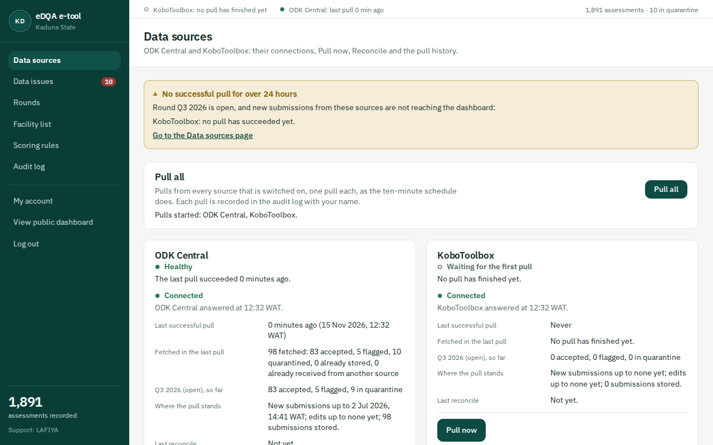

This page shows the two places submissions come from, **ODK Central** and **KoboToolbox**.

- **A panel for each source** shows its state:
  - **Connected**: all is well.
  - **Behind**: no successful pull for over 30 minutes.
  - **Credentials rejected**: the source refused the portal's sign-in details.
  - **Not configured**: the source has not been set up.

  The panel also shows when the source was last pulled and what came in. If a source shows an
  error, the panel says what it means in plain words. The settings themselves can only be fixed
  on the server, by the technical team.
- **Pull now** (one source) fetches new and edited submissions. **Pull all** does both sources
  together. A progress panel per source counts what was fetched, accepted, flagged, quarantined,
  already stored and "from another source". It shows **Finished** at the end. Pulls also run on
  their own every few minutes, so you only need these buttons when you want something in now.
- **Reconcile** compares the open round with the source. It applies edits made at the source and
  lists submissions deleted there. It also runs every night by itself.
- **Pull history** lists every pull, who started it and how it went. It can be filtered by source.
- **Deletions at source** lists accepted submissions that have since been deleted on ODK Central
  or KoboToolbox. You deal with them on Data issues (section 6).
- **Facility media file**: **Regenerate facility media file** produces the lists of LGAs, wards
  and facilities that the form offers to assessors (section 7).

### Data issues

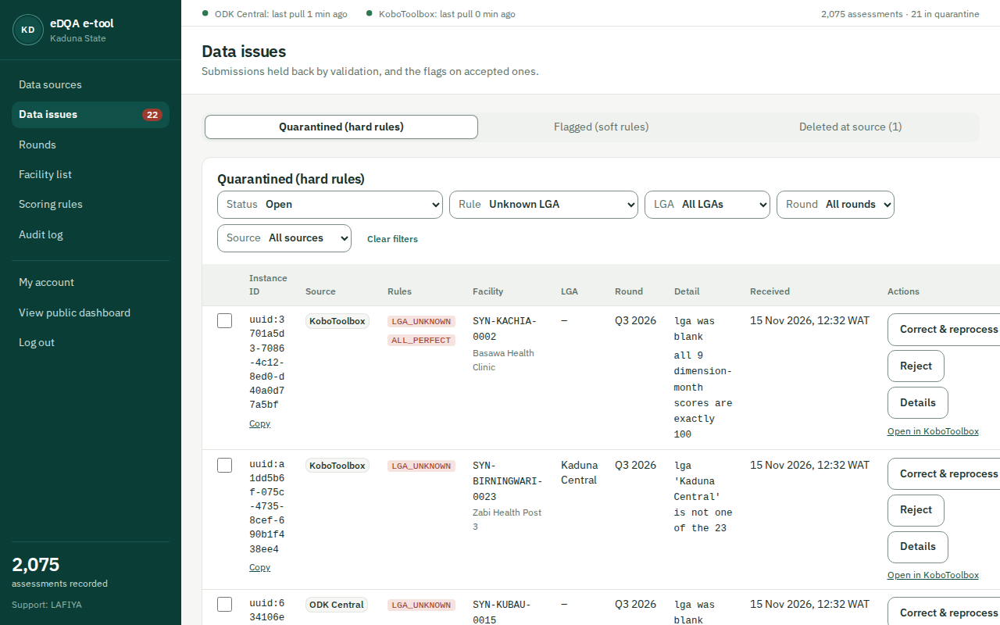

Every submission is checked before it can affect any figure. One that breaks a **hard rule** is
**held back** (quarantined): it counts nowhere until you deal with it. One that only looks odd is
**accepted with a flag**: it counts, and the flag asks you to look. The page has three tabs:

- **Quarantined (hard rules)**: held-back submissions. Pick a rule in the rule list to see only
  those. Filter by status (open, resolved, rejected), rule, LGA, round or source.
- **Flagged (soft rules)**: accepted assessments with a flag.
- **Deleted at source**: accepted assessments whose submission was deleted on ODK Central or
  KoboToolbox.

What you can do with a held-back submission:

- **Correct & reprocess**: fix the LGA, ward, facility, visit times or round. Only these can be
  corrected; answers and scores never can. The submission as sent never changes: your
  correction is laid over it. It then goes through every check again. If it passes, it becomes
  an assessment and its round is rescored.

  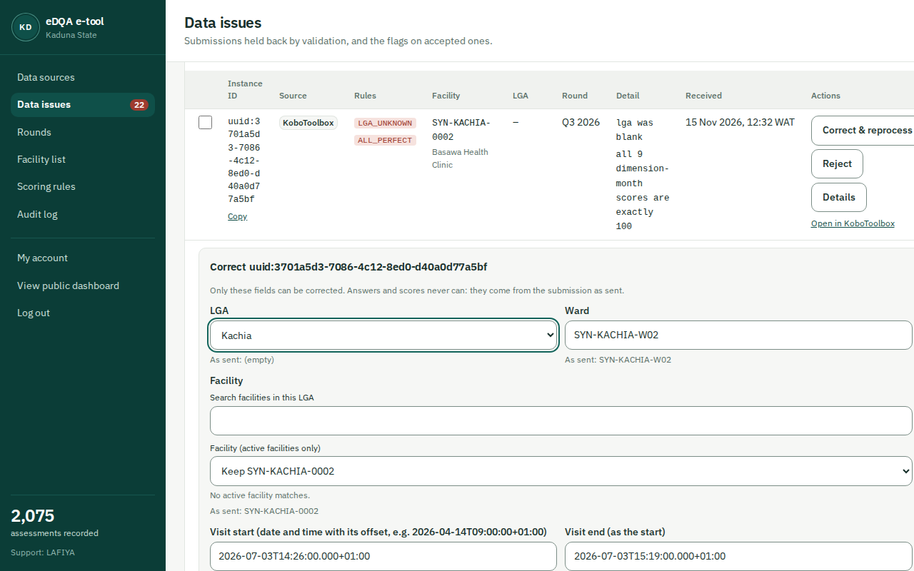

- **Reject**: it leaves quarantine for good and is never scored. A reason is required.
- **Several at once**: tick the boxes, then use the bar that appears to **reject** them all, or
  to give them all the same correction.
- **Open in ODK Central / KoboToolbox**: see the submission where it was entered.

On a flagged assessment, **Override** removes the flag and keeps the scores. A reason is required.

Section 5 explains every rule and how to fix it.

### Rounds

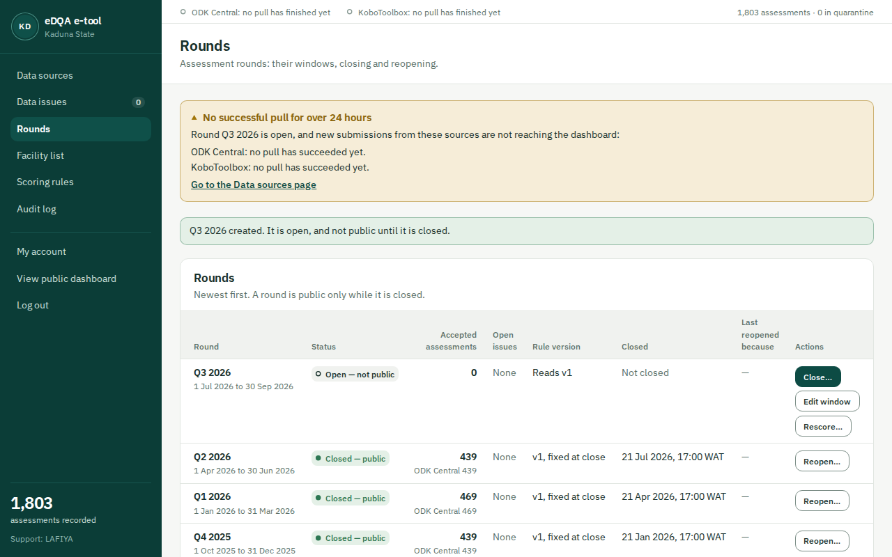

A **round** is one quarter: Q1 is January to March, and so on. It takes in the visits whose date
falls in its **window**.

- **Create a round**: the form offers the quarter after the last one, with that quarter's dates.
  The window may end up to a few days after the quarter, for late visits. It may not share a day
  with another round. A new round is **open**, and an open round is **not public**.
- The table shows each round's window, status (**Open — not public** or **Closed — public**),
  accepted assessments per source, open issues, the rule version it reads, and who closed it.
- **Edit window**: change the dates, with a reason.
- **Close…**: publishes the round (section 4). **Reopen…**: takes it off the public dashboard
  again, with a reason. **Rescore…**: scores every assessment again from its answers.

### Facility list

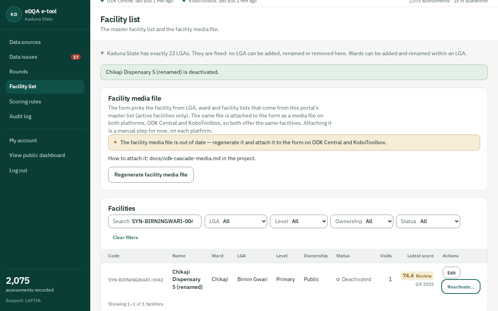

The master list of facilities. It is the authority: a submission for a facility not on it (or
deactivated) is held back.

- **Search** by name, code, ward or LGA, and filter by LGA, ward, level, ownership and status.
- **Edit**: change a facility's name, ward, LGA, level, ownership or coordinates. A code cannot
  change once assessments are recorded under it. Names and ward or LGA changes show on the
  public dashboard, for published rounds too.

  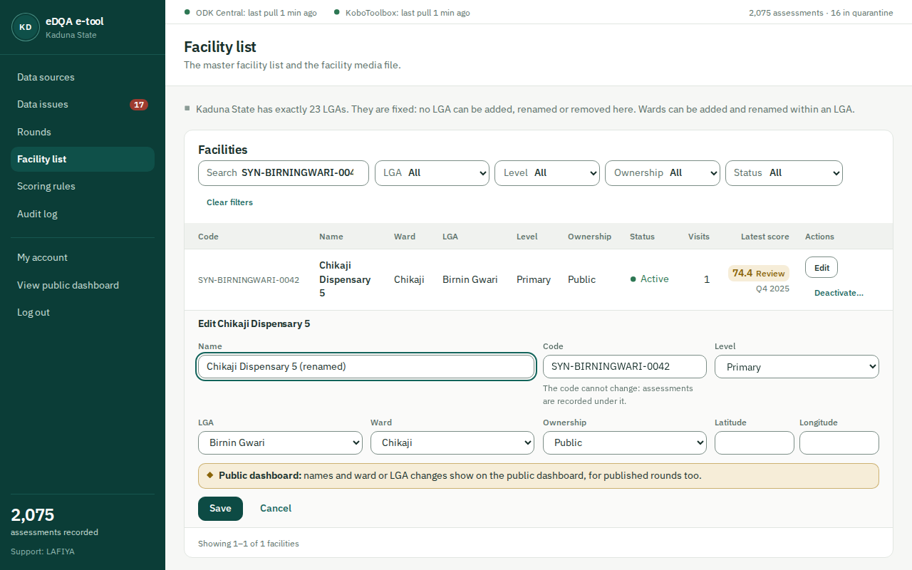

- **Deactivate…**: the facility leaves the form's lists. It is **never deleted**, and its
  published history stays on the public dashboard. A reason is required. If it has visits in the
  open round, the dialog says so: they still count, but later submissions for it will be held
  back. **Reactivate…** brings it back.
- **Add a facility** and **Wards** (add or rename wards within an LGA) are below the list.
- The **23 LGAs are fixed**. None can be added, renamed or removed.
- After any change, the page says **"The facility media file is out of date"**. Regenerate it
  right there, then attach it to the form on both platforms (section 7).

### The facility view (admin)

Open it from a facility's drawer on the public pages (**Open the admin facility view**), or from
links in the admin area. It shows everything recorded for one facility: every round's scores,
answers, flags, photos and attachments, its source and a link to it, and a **Changes** list of
everything done to it.

**Correct this assessment** lets you change answers (Pass, Fail, N/A) on an accepted assessment.
A summary shows what you changed, and you give a reason. The scores are worked out again from
the answers. The original stays at the source, and the page reminds you that the two now differ.

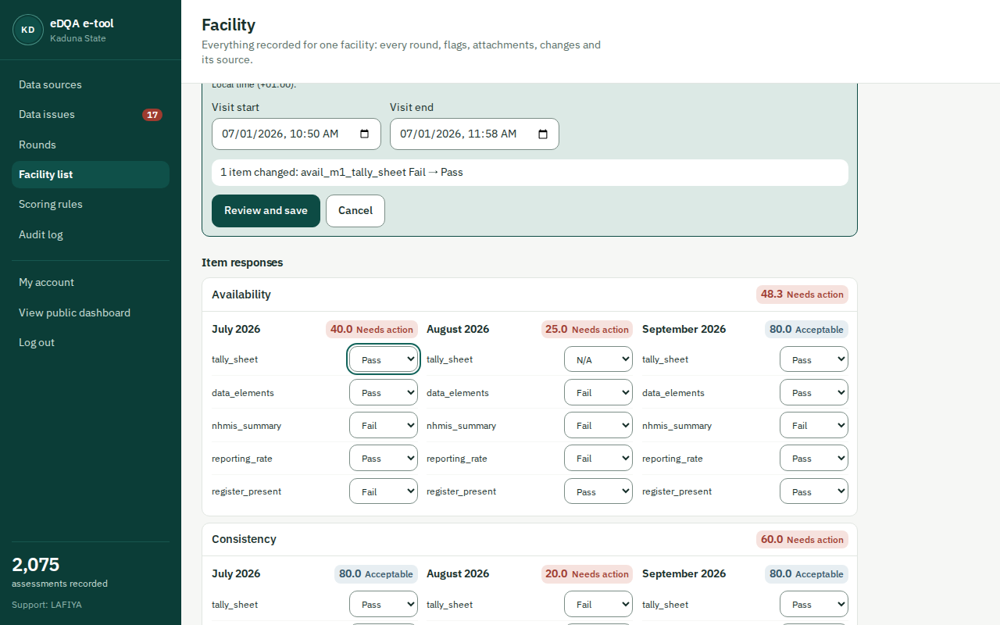

### Scoring rules

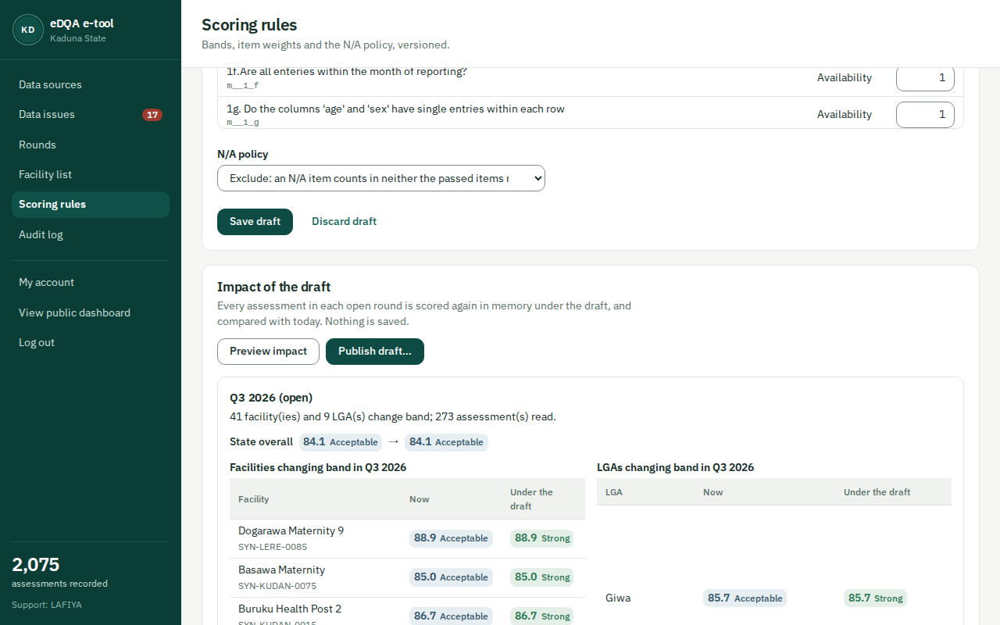

How answers become scores and bands: the band thresholds (Strong, Acceptable, Review, Needs
action), item weights, and what N/A means. Rules are kept in **versions**.

1. **Start a draft** from the current version and change it. **Save draft** keeps it; nothing
   changes yet.
2. **Preview impact** scores every open-round assessment under the draft and lists the
   facilities and LGAs that would change band. Nothing is saved.
3. **Publish draft…**, with a reason, makes it the current version. **Open rounds are rescored
   at once. Closed rounds keep the version they were closed with**, so published figures do not
   move. The public dashboard only changes when an open round is closed.

### Implementation plan

The follow-up for the local governments below the threshold (Acceptable, by default): who acts,
by when, and how far it has got. Choose the round at the top, open or closed.

- **Generate plan for this round** saves a row for every LGA that needs one: its weakest dimension,
  the standard action, the usual owner, and a review date 30 days ahead. Rows you have already saved
  are never changed, so running it again is safe.
- For each row you can set:
  - **Owner:** a role from the list, or **Other role…** to write one in. Write a role or unit,
    never a person's name: the owner shows on the public plan.
  - **Contact** (optional) and **Notes:** for administrators only. They never appear publicly.
  - **Review date:** a new date must be today or later. A date that has passed is pointed out.
  - **Status:** Not started, In progress or Done.

  Press **Save** on the row. No reason is needed, but every change is in the audit log.
- Plans for closed rounds stay editable: they are follow-up, not published figures.
- **Actions by type** counts the actions of each kind by status.
- The public Implementation plan page shows, for closed rounds only, each LGA's overall, weakest
  dimension and score, the recommended action, the owner role, the review date and the status.

### Audit log

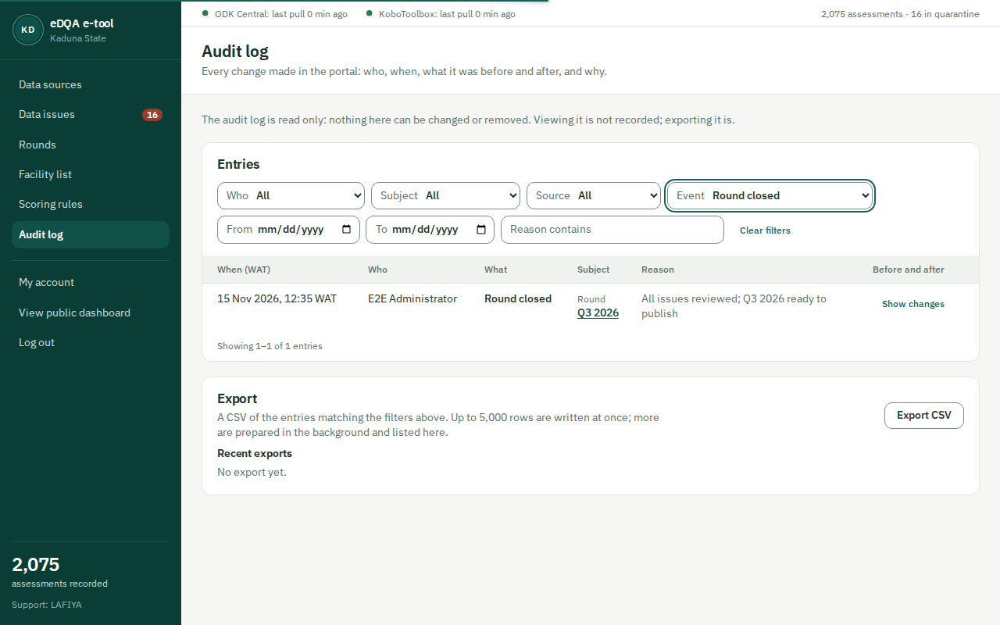

Every change made in the portal, by anyone: who, what, when, the subject (with a link), the
reason, and the before and after values. Sign-ins, failed sign-ins and lockouts are there too.
Filter by person, kind of subject, source, event, dates or words in the reason. **Export…**
downloads what the filters show (see "Exports" below). The log cannot be edited or deleted by
anyone.

### My account

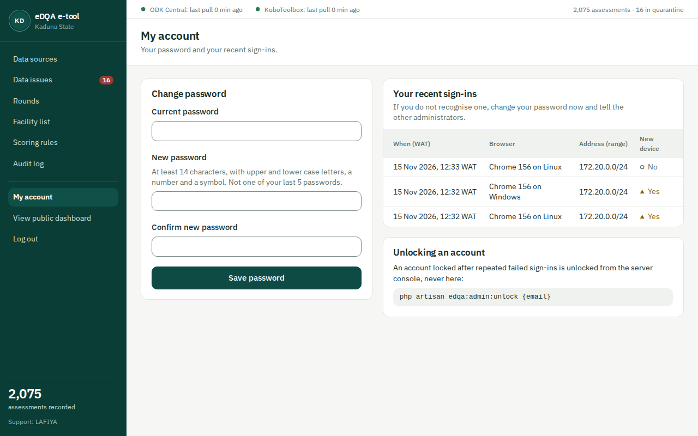

Change your password, and see your **last ten sign-ins**: when, the browser, roughly where from,
and whether it was a new device. If you do not recognise one, change your password now and tell
the others.

---

### Exports

Every figure the portal shows can be taken away as a file, with **Export…**. You choose CSV or
Excel, and the file holds exactly what the page shows, for the filters in view.

| Where | What you can export |
|---|---|
| Admin preview bar, Home and Monitor | State summary: the headline, the three dimensions, public and private, coverage |
| Admin preview bar, Facility view | Facility scores (every page, every metric), or item responses (one row per item) |
| Admin preview bar, LGA view and Implementation plan | The LGA table |
| Admin preview bar, Visuals | State summary or LGA table |
| Data issues (hard rules tab) | The held-back records, with rule codes and details |
| Data sources | The pull history; and, per source, the backfill report (Excel only: what each source's history became, by round, by rule, by form version, examples, and the facilities that did not match the master list) |
| Audit log | The entries shown |

- **It is prepared in the background.** The panel shows its progress, then a download link that
  works for 30 minutes. The file is deleted after 7 days; export again for a new copy.
- **Every score comes three ways:** the exact value, the value as the dashboard shows it (one
  decimal place), and its band.
- **Open-round rows say "Provisional — round not closed".** Only closed-round figures are
  published.
- **Excel files have an "About this file" sheet:** the filters, when and by whom it was made, the
  scoring rule version, how values are rounded and averaged, the data sources, and whether
  personal details are in it.
- **Personal details:** item responses can include assessor names, device IDs, visit GPS, source
  links and attachment links, but only if you tick **Include assessor and source details**. The
  file then holds personal data: keep it safe. Your choice is recorded in the audit log.
- Every export and download is in the audit log.

---

## 4. Running a round from start to finish

The usual order. The end-to-end test does exactly this on test data.

1. **Before the quarter's visits:** check the Facility list is up to date. If anything changed,
   regenerate the facility media file and attach it on both platforms (section 7).
2. **Create the round** on Rounds. It is open and not public.
3. **Submissions come in.** Pulls run automatically. To bring everything in now, use **Pull all**
   on Data sources and watch both progress panels reach **Finished**.
4. **Work through Data issues** for this round, most often weekly while visits are going on:
   - correct what can be corrected, reject what is not a real visit;
   - decide duplicates between the two platforms (section 6);
   - review deletions at source (section 6);
   - look at flags, and override any that turn out to be fine.
5. **Correct assessments** where a supervisor finds a wrong answer (facility view).
6. **If the scoring rules change** for this round, draft, preview and publish them **before**
   closing. A closed round keeps the rules it closed with.
7. **Close the round** on Rounds, with **Close…**:
   - the panel lists what is still open in the round. You can close with open issues, but say
     why in the reason;
   - press **Reconcile all sources now** first. It catches edits and deletions made at the source
     since the last pull. Wait for both to show **Finished**;
   - press **Close round…**, give a reason and confirm **Close and publish**.

   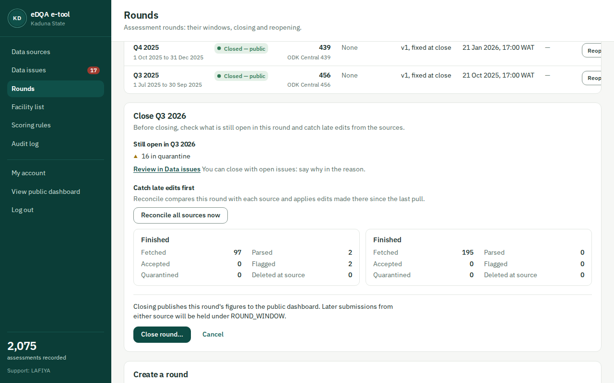

8. **Check the public dashboard** (log out, or use a private window). The round is there, and
   "Figures last updated" at the foot of each page shows today's date.

   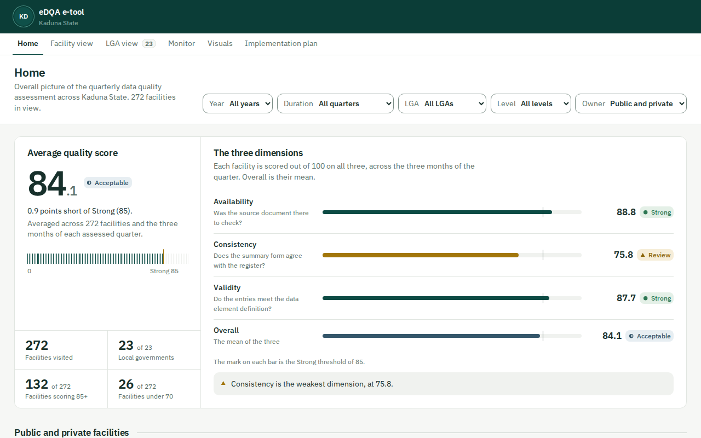

### What "closing publishes" means

- **Closing is publishing.** Until a round is closed, nobody outside the admin area can see any
  of its figures. The moment it closes, its figures appear on all six public pages, and "Figures
  last updated" moves to that moment.
- **The figures are then fixed.** The round keeps the scoring rule version it closed with, even
  if the rules change later. Submissions arriving afterwards for that quarter are held back as
  "Outside the round window", and nothing in a closed round can be corrected, withdrawn or
  restored.
- **To change a closed round, reopen it**, with a reason. It disappears from the public dashboard
  at once. It is rescored under the current rules, and comes back when you close it again.

---

## 5. What each data issue means and how to fix it

**Hard rules** hold a submission back. **Soft rules** accept it with a flag.

| Issue | What it means | How to fix it |
|---|---|---|
| **Unknown LGA** | The LGA was blank, or is not one of the 23. | If the facility code shows the right LGA, **Correct & reprocess** with it. If it is not a real visit, **Reject**. |
| **Unknown facility** | The facility is not on the master list, is deactivated, or the code looks like a number or year (for example "2019.00"). | Pick the right active facility in **Correct & reprocess**. If the facility really exists but is missing, add it on the Facility list, regenerate the media file, then reprocess. |
| **Facility in the wrong LGA** | The facility's LGA on the master list differs from the LGA submitted. Usually the wrong option was picked in the form. | Correct the LGA (or the facility) to match. If the master list is wrong, fix it on the Facility list first. |
| **Missing items** | A dimension or month has no answers, an answer the form does not allow, or the form recorded typed scores instead of answers. | Answers cannot be corrected in the portal. Have the assessor **fix it at the source** (section 7); the edit comes in with the next pull or reconcile. Otherwise **Reject**. |
| **Score out of range** | A value above 100 or below 0. | Fix at the source, or **Reject**. |
| **Visit ends before it starts** | The end time is before the start time. | **Correct & reprocess** with the right times, if known. Otherwise fix at the source. |
| **Outside the round window** | The visit date falls in no open round. It may be in a closed round, in no round at all, or the form named a different quarter. | If the date is wrong, correct the visit times or round. If a round is missing, create it, then reprocess. If it is test data, **Reject** (several at once if needed). If its round is closed and it must count, reopen the round first. |
| **Duplicate assessment** | The facility already has an assessment in this round. This one may be from the same platform or the other. | Compare both sides on the page, then **Keep the existing one** or **Use this one instead** (section 6). |
| **Shifted columns** | Values landed in the wrong fields, such as a ward called "Quarterly" or a date of "FEBRUARY". | Usually a form problem. Correct what you can, or fix at the source; tell the form owner. |
| **Unknown form version** | The form was changed and redeployed, and the portal does not know the new version yet. | Do not reject these. Ask the technical team to add the new version. The held submissions are then reprocessed and nothing is lost (section 7). |
| **Rule could not run** | One of the portal's checks failed with an error. | Tell the technical team. It is reprocessed once the check is fixed. |
| *Large score change* (flag) | The facility's overall score moved a lot since its last round. | Check the answers with the supervisor. If they are right, **Override**; if not, correct the assessment. |
| *Every score perfect* (flag) | All nine scores are exactly 100. | Check the visit really happened. Override or withdraw accordingly. |
| *Very short visit* (flag) | The visit was much shorter than a real assessment takes. | Ask the supervisor. Override if it was genuine. |
| *Many visits in one day* (flag) | One assessor recorded more visits in a day than is realistic. | Ask the supervisor to confirm. |
| *Source edit replaced a portal correction* (flag) | The submission was edited at the source after you corrected it in the portal. The source's version now stands; your correction is kept in the audit log. | Check which answers are right and correct again if needed. |

Every action on this page needs a reason, and every action is recorded in the audit log.

---

## 6. Duplicates and deletions between ODK Central and KoboToolbox

Assessments can be entered on either platform. A facility should still be assessed **once per
round**, and the portal makes sure nothing counts twice.

### The same submission on both platforms

Sometimes a submission is copied from one platform to the other, with the same ID. The portal
stores it once. The copy is only counted as **"From another source"** in the pull's progress and
in the Rounds table's issues. **There is nothing to do.**

### The same visit entered twice

The same facility can be assessed in the same round on both platforms, or twice on one. The
first one accepted counts; the second is held back as **Duplicate assessment**. Data issues shows
**both sides** next to each other: source, assessor, date and the overall score each gives.

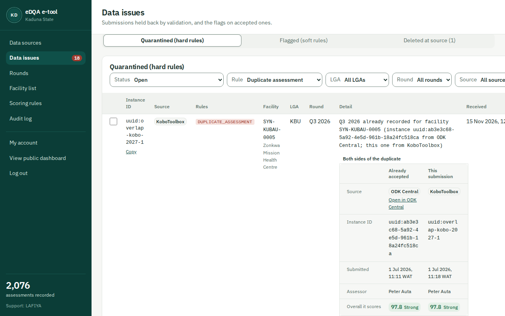

- **Keep the existing one**: the held submission is rejected; the accepted assessment stays.
- **Use this one instead**: the held submission replaces the accepted one. Its answers and scores
  take their place, the earlier one is marked superseded, and the round is rescored. Both IDs are
  recorded with your reason.

Ask the supervisor which visit was real if it is not obvious. Then ask the assessor to delete the
unwanted one at its source, so the two platforms agree.

### A submission deleted at the source

The portal **never removes an assessment by itself** when a submission is deleted on ODK Central
or KoboToolbox. Removing published figures is a decision. A reconcile notices the deletion and
lists it under **Deleted at source** on Data issues:

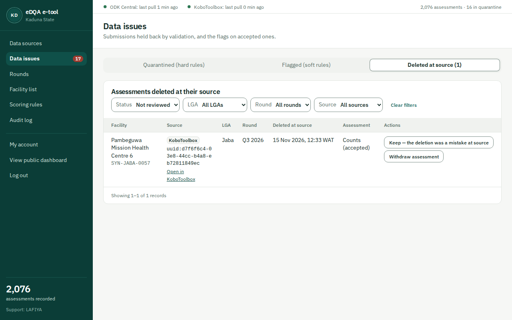

- **Withdraw assessment**: it stops counting in every figure, and the round is rescored. The
  facility can be assessed again in that round. A withdrawn assessment can be **restored** later,
  with a reason.
- **Keep — the deletion was a mistake at source**: the assessment keeps counting, and the
  deletion is marked reviewed.

Both need a reason. In a closed round neither is possible: reopen the round first.

---

## 7. What must be done on ODK Central or KoboToolbox instead

The portal only ever **reads** from ODK Central and KoboToolbox. It never changes anything there.
Some things can therefore only be done on the platforms themselves.

### Attaching the facility media file (both platforms)

The form's LGA, ward and facility lists come from the portal's master list, as a **media file**.
Whenever facilities are added, renamed, moved, deactivated or reactivated, and before each round:

1. On **Facility list** (or Data sources), press **Regenerate facility media file**. Download the
   file from the link that appears; the link works for 30 minutes.
2. On **ODK Central**: open the project, then the DQA form, and create a new draft. Under **Form
   Attachments**, upload the files. Publish the draft.
3. On **KoboToolbox**: open the form, go to **Settings → Media**, replace the files, then
   **redeploy** the form.
4. Ask assessors to update the form on their devices (in ODK Collect or KoboCollect: get the
   latest form) before their next visit.

Full steps: [odk-cascade-media.md](odk-cascade-media.md).

Until the file is attached, assessors keep seeing the old lists. A deactivated facility can still
be picked on their devices; its submissions are then held back as "Unknown facility".

### Fixing answers at the source

The portal can correct **where and when** a visit was (LGA, ward, facility, times, round), and an
administrator can correct answers on an accepted assessment. A submission held back for missing
or impossible answers cannot be repaired in the portal. It must be **edited at the source**:

- on ODK Central, edit the submission (or ask the assessor or a project manager to);
- on KoboToolbox, edit the submission in the form's data table.

The edit reaches the portal with the next pull or reconcile. Reconcile runs every night, or press
**Reconcile** on Data sources. The edit goes through every check again.

Deleting a submission at the source does not remove it from the portal. It appears under
**Deleted at source** for your decision (section 6).

### Form changes and redeploys

Changing the form itself (adding, renaming or removing questions) and redeploying it creates a
**new form version**. The portal reads each version through its own map of questions. A version
it does not know is held back as **Unknown form version**, never guessed at.

- **Before** redeploying a changed form, tell the technical team, so they can add the new version
  first.
- If it has already happened, do not reject the held submissions. Once the version is added they
  are reprocessed and nothing is lost.
- Redeploying only to attach a new media file does not change the questions. Those submissions go
  through normally.

### Accounts and settings on the platforms

The portal's connection details for each platform (address, account, token) live on the server.
If a source shows **Credentials rejected** after a password or token change on the platform, ask
the technical team to update the server.

---

## 8. Things to remember

- **Nothing is public until you close the round.** Closing publishes it; reopening hides it.
- **Every change needs a reason** where it matters: rejecting, overriding a flag, correcting,
  closing or reopening, publishing rules, deactivating a facility, withdrawing or restoring, and
  using one submission instead of another. All of it is in the audit log, with your name.
- **Nothing is ever deleted.** Submissions as sent, facilities and the audit log are kept.
  Rejected, withdrawn and deactivated things stop counting, but remain on record.
- **Scores are always worked out by the portal** from the answers. Nobody types a score.
- **Kaduna has 23 LGAs, always.**
- **The platforms are only read.** Fixes to answers, form changes and media files happen on ODK
  Central and KoboToolbox.

Problems the portal cannot solve, such as sign-in settings, unlocking an account, a new form
version or a source that keeps failing, go to the technical team.
c